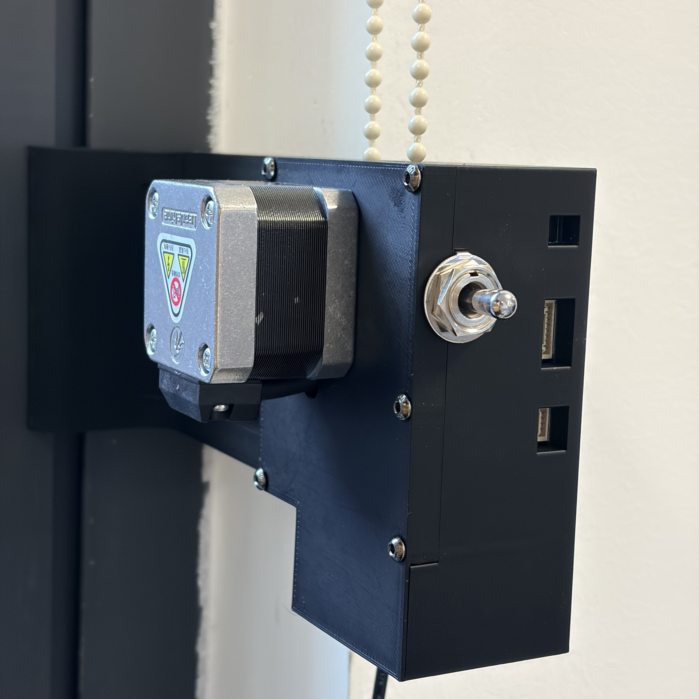
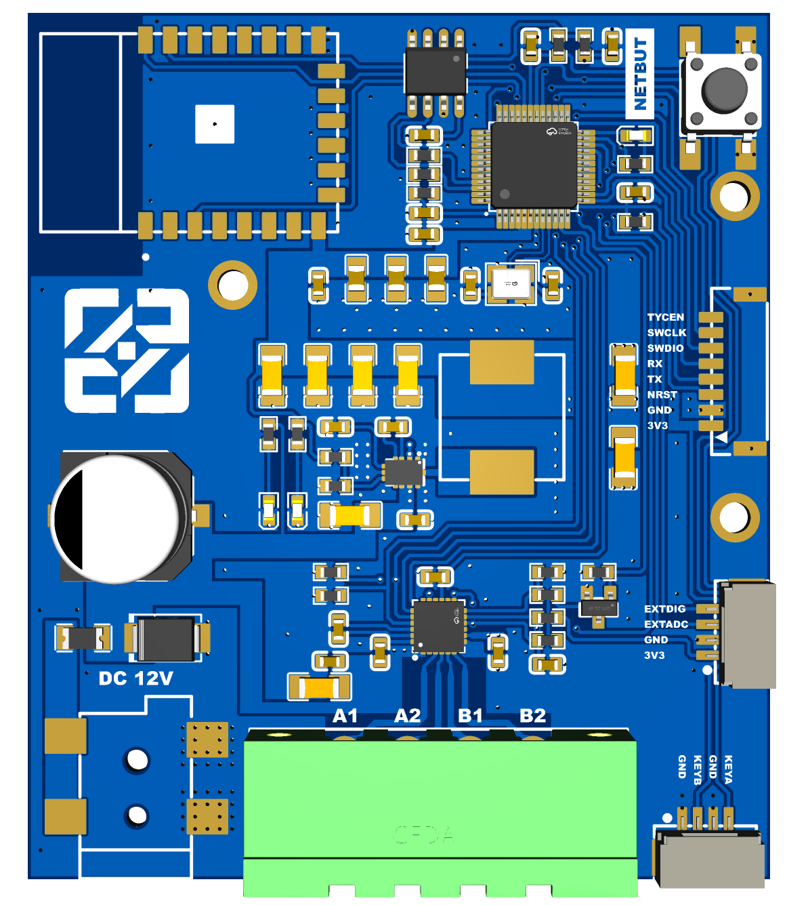

# 自动窗帘抬升器 · Automatic Curtain Lifter

面向拉珠式卷帘的 12 V 智能升降控制器。采用 **STM32G030C8T6 + DRV8434A + 涂鸦 T1-3S**，配合步进电机和 9 槽珠链轮，实现本地操作、App 百分比定位及上下端点校准。

项目仓库：[XJH-Jorhai/automatic-curtain-lifter](https://github.com/XJH-Jorhai/automatic-curtain-lifter)。

**当前基线：2026-10-25 Product v15。** 本仓库公开开发版源码与设计资料。当前样机功能已验证；提供电气工程、原理图 PDF/SVG、制造文件、实装 BOM、机械 STEP 与 3MF。第三方 SDK 需自行取得，完整新账户复现尚未完成。当前接入平台是涂鸦，米家属于历史调研，尚未正式接入。

## 样机与主板

  
  

左：作者提供的安装样机实拍。右：主板 PCB 渲染图，用于展示布局，不能据此确认全部器件已经装配；采购与接线以实装 BOM、修改单及引脚表为准。

## 已实现的功能

- 本地短拨点动，保持 1 秒后自动运行；反向先停，再持续保持换向。
- App 开/停/关、0–100% 目标定位，目标与当前进度独立显示。
- 实体按键及 App 手动保存上下端点，边界外按住微调、松手即停。
- TRQ 负载信号滤波检测、故障与超时停机。
- EEPROM 双槽校准日志，保存行程和用户上端距物理顶的偏移。
- 电机启动旋律、调试接口与带进度浮条的烧录入口。

**重启行为：** 保存校准不等于保存可信当前位置。首次需要定位的 App 操作可能先向上寻找物理顶，再到目标；开机本身不会自动运动。设备没有编码器，未知位置的中间进度只是估计显示。

## 阅读与复现

| 入口 | 内容 |
|---|---|
| [文档总览](docs/README.md) | 当前实现、证据与历史资料分类 |
| [硬件与机械设计](docs/hardware-design.md) | 电源、驱动、引脚、珠链轮及制造资料状态 |
| [软件设计](docs/software-design.md) | 状态机、位置参考、TRQ、EEPROM、涂鸦 DP |
| [构建与使用](docs/getting-started.md) | 依赖、可配置的构建命令、测试、烧录及操作 |
| [验证状态](docs/validation-status.md) | 已测功能、证据和未验收指标 |
| [发布准备](docs/release-checklist.md) | 开源文件、许可证、复现及制造包清单 |
| [发表稿](docs/publication-draft.md) | 项目介绍草案 |

Product 源码位于 [firmware/g030_mainboard](firmware/g030_mainboard/)，详细行为见 [PRODUCT.md](firmware/g030_mainboard/PRODUCT.md)。生成的涂鸦 SDK 不随 Git 提交，目前仍需外部取得兼容模板；请先读构建说明，不把克隆成功当作依赖已经齐全。

## 仓库结构

| 目录 | 用途 |
|---|---|
| `firmware/g030_mainboard/` | 当前产品、诊断构建、测试和 CubeMX 配置 |
| `firmware/g030_tuya/` | 历史联网台架及产品仍复用的 SDK 移植脚本 |
| `hardware/` | 电气设计快照、机械模型和实板测试记录 |
| `docs/` | 当前软硬件文档与编号历史设计资料 |
| `tools/flash_monitor/` | 烧录浮条及对应 API/CLI |
| `vendor/` | 第三方资料说明；原始包默认忽略 |
| `work/`、`tmp/` | 本地构建/临时资料，不作为源码提交 |

## 验证与许可

[v15 实板记录](hardware/test-records/2026-10-25-product-v15.md)包含构建、回归、烧录读回和用户验收。待机功耗 ≤100 mW 仍是未完成验收的目标；长期温升、寿命及多种机构适用性不能由单机功能测试推出。

自有软件采用 MIT、原创硬件采用 CERN-OHL-P-2.0、原创文档采用 CC-BY-4.0，范围见 [LICENSING.md](LICENSING.md)。第三方代码、模型、SDK 和资料按各自来源处理，见 [THIRD_PARTY_NOTICES.md](THIRD_PARTY_NOTICES.md)。当前资料准备不表示涂鸦云服务或模组固件一并开源。

当前交付见 [电气制造候选](hardware/release-2026-10-25/README.md)、[外壳 3MF](hardware/mechanical/README.md)、[涂鸦依赖](docs/tuya-setup.md)及[隐私审查](docs/privacy-review.md)。

涂鸦接入方法见 [产品、DP、面板与 MCU 联调设计指南](docs/tuya-design-guide.md)，不随仓库发布涂鸦模组固件。
