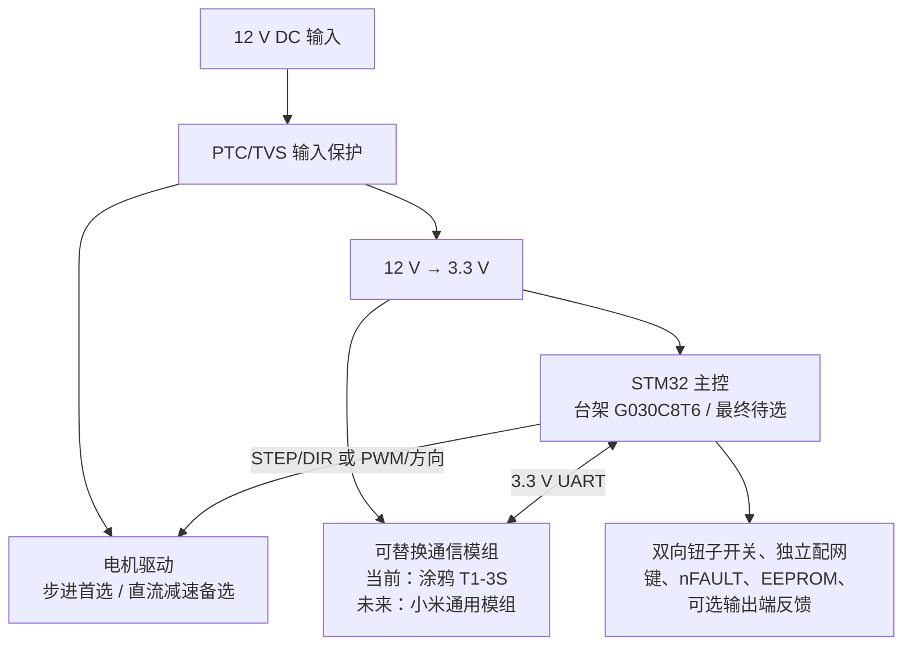
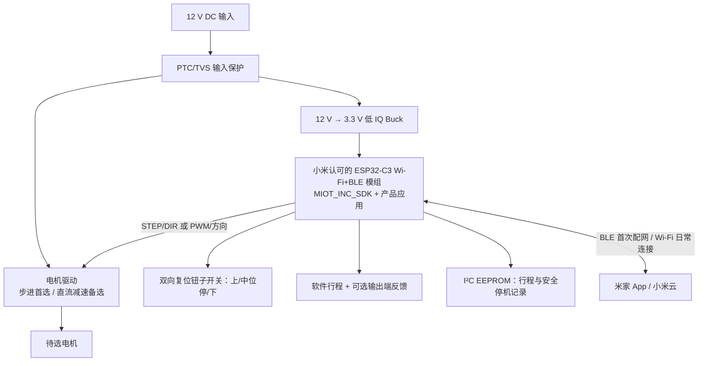

# 系统架构和数据设计

## 当前个人 PoC 决策：STM32 主控 + 可替换通信模组

架构上由 STM32 独立承担运动与安全控制，涂鸦 T1-3S 负责首版配网、App 与云通信。首版主控已定 STM32G030C8T6，开发板已完成无电机联网和 DP 联调。未来取得米家企业或服务商支持时，再评估替换通信模组及平台适配。

这条路线增加一颗芯片，联网静息 `<100 mW` 的风险高于单 SoC。PoC 必须分别测量通信模组和 STM32 子系统；若正式米家通用模组无法达到目标，需要重新权衡功耗指标、在线响应或架构。

## 参考架构 A：单 SoC 官方 SDK（当前不选）

优点是少一颗 MCU、静息功耗低、整板简单，且电机应用代码仍由项目维护。成立条件是小米 SDK 允许访问所需 GPIO、硬件定时器、I²C 和低功耗 API。

## 架构 B：通用模组 + STM32（当前路线）

T1-3S 负责平台协议和模组 OTA。当前 G030 台架通过 3.3 V、9600-8-N-1 UART 交换 DP，已验证联网与 App 往返；电机类型及输出接口、本地钮子开关、低力矩寻找上端限位、自主双端校准、EEPROM 和位置估算仍是下一阶段工作。下端反卷顿挫能否检测待实测；不允许为此改装窗帘或窗框。未来米家阶段计划替换 `platform_tuya` 为 `platform_miot`。当前涂鸦 MCU OTA 尚未启用，不能把双固件 OTA 当作已完成能力。具体帧、DP 和安全映射见[涂鸦 T1-3S 接入基线](07-tuya-t1-3s-integration-baseline.md)，电机比较见[选型决策](09-motor-drive-decision.md)。

## 固件分层

- `platform_tuya`：计划从当前 `firmware/g030_tuya/App/` 抽取 T1-3S UART、DP 映射、网络状态和全量状态快照
- `platform_miot`：未来米家配网、属性读写/notify、OTA、时间与设备身份
- `motion`：梯形/S 曲线加减速、方向、目标步数、普通停止、软件行程和超时
- `position`：步数与 0–100% 换算、行程标定、可信度状态
- `storage`：网络由官方 SDK/NVS 管理；行程和安全停机位置用带 CRC 与序号的 EEPROM 轮转记录
- `input`：钮子开关两侧输入消抖、中位停止、独立配网键和驱动故障输入
- `power`：驱动休眠/使能、LED 关闭、Wi-Fi power-save、复位后状态处理

## 持久化策略

网络凭据、设备绑定信息和产品身份沿用官方 SDK 的 NVS 机制，不自行复制明文。V3 原理图 U4 已改为 Microchip AT24C16C-SSHM-T（C6480，16 Kbit I²C EEPROM）。它是断电保留数据的低成本存储器；普通易失 RAM 不适合存行程参数。固件存储策略同步调整：

- 记录结构含 magic、schema version、sequence、position_steps、open_steps、close_steps、direction、CRC32；写入采用 16 字节页边界内的分页写和写后校验。多个独立记录槽轮转，保留上一条已校验的有效记录，以抵御写入中断。
- 仅在校准成功或受控停机且数据变化时提交记录；运动中位置按 STEP 在 RAM 中计算与上报，不再按 1% 或每秒写 EEPROM。故障或复位时先切断驱动；PA1 电压检测已删除，不能指望提前识别输入电源跌落并提交记录，不能依赖最后一次写入完成。
- 上电只恢复行程参数与上次保存的参考位置，**位置可信度一律先置为不可信**，不自动运行；下一次定位命令须受控寻找上端恢复零点。若行程记录无效，则下一次新鲜的 0%/100% 命令重新完成双端校准。这样可防止运动中断电时把旧位置误认为当前绝对位置。
- AT24C16C 标称 100 万次写入耐久（数据手册的页写测试条件）和最长 5 ms 写周期；轮转槽数、允许的每日动作次数和十年写入预算要在固件实现时计算并验证。I²C 地址与 FRAM 不可直接按旧驱动复用。[Microchip 数据手册](https://ww1.microchip.com/downloads/en/DeviceDoc/AT24C16C-data-sheet-20006051A.pdf)。

## 本地开关语义

- U6 为双向自动复位钮子开关。1 脚为 `KEY_DOWN`→PC7、2 脚接 GND、3 脚为 `KEY_UP`→PC6，两路低有效。设想拨上导通 1-2、拨下导通 2-3，当前信号名与该设想相反；装板后实测朝向并在软件中映射，硬件无需重接。松手回中位只停止该次本地运动；软件须消抖并避免换向瞬间反向冲击。
- 原独立停止键已删除；SW1 是接 PC13 的独立 `NETCONTROL_BTN` 配网键。恢复出厂可复用此键，但长按时序和防误触仍由固件定义。
- 首次本地端点命令可能触发自主双端校准；本地开关松手即停与校准无需人工持续拨住的要求如何配合，尚待软件交互定义。

恢复出厂是唯一清除网络凭据的操作，普通掉电、看门狗复位和 OTA 均不得清除。
