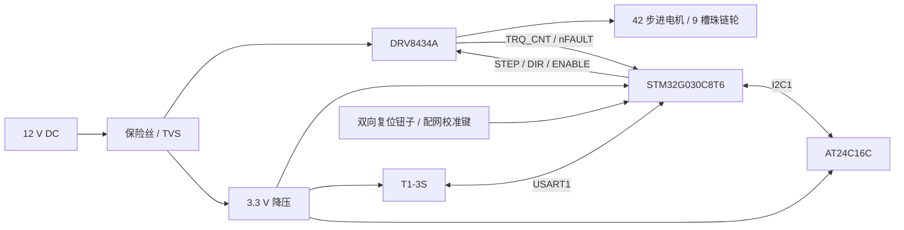

# 硬件与机械设计实现

本页整理现有主板和样机，不作为已冻结的投板 BOM。电气接口以 [2026-10-20 网表](../firmware/g030_mainboard/hardware/mainboard-2026-10-20.enet)和[引脚表](../firmware/g030_mainboard/PINOUT.md)为依据，实装改阻另见下文。

## 系统结构

系统驱动原窗帘珠链，无外置端点开关或编码器。电机指令脉冲提供相对位移，驱动器负载信号用于寻找机械参考和异常停机。珠链轮、安装方向和卷帘负载共同影响检测参数。

## 电源与器件

| 模块 | 现有实现 | 复刻注意 |
|---|---|---|
| 主控 | STM32G030C8T6，LQFP48 | 固件使用 HSI16；板上 8 MHz 晶振不等于已启用 |
| 电机驱动 | DRV8434ARGER | M0/M1 接 DVDD，固定 1/8 微步；STL_MODE 接地 |
| 存储 | AT24C16C-SSHM-T | 2048 字节，16 字节写页；不是 FRAM |
| 无线 | 涂鸦 T1-3S | 需要匹配的模组固件、产品 DP 与平台授权 |
| 降压 | LMR33630 电源方案 | 12 V 主电源转换为 3.3 V 逻辑电源 |
| 输入 | DC-050-A250、F1、SMBJ15A TVS | 早期防反接 MOS 已取消；插头不能按旧 DC5521 采购 |
| 电机/机构 | 42CM02-1A 方案与 9 槽珠链轮 | 最终随样机的电机标签、线序与装配 BOM 仍需统一记录 |

以上来自仓库网表、引脚表及设计审阅记录；完整阻容、封装和采购料号应从与实板一致的工程重新导出。历史 `BOM-review.md` 是变更记录，不能直接当作采购清单。

2026-10-21 实装电流网络为 R4=30 kΩ、R5=21 kΩ、R6=4.7 kΩ；唤醒驱动且禁用绕组时 VREF 实测 1.978 V，换算满量程约 1.50 A。**这不是绕组电流实测，也不是整机长期连续额定值。** 当前 Product 上下行与启动旋律均用原电流档；早期音乐低档描述不适用。温升和电机允许持续电流仍需按最终装配验证。

## 关键连接

| 功能 | MCU 引脚 | 实现 |
|---|---|---|
| STEP / DIR | PA6 / PA7 | TIM14 中断生成脉冲；本机已确认 DIR0 上卷 |
| ENABLE / nSLEEP / nFAULT | PB0 / PB1 / PB2 | 复位下拉禁能；故障信号由 GPIO 读取 |
| TRQ_CNT / 电流档 | PA0 / PA4 | ADC 负载信号；PA4 控制 VREF 档位 |
| 涂鸦 UART | PA9 TX / PA10 RX | Product 为 9600 8N1，连接模组 RX1/TX1 |
| 调试 UART | PA2 TX / PA3 RX | 115200 8N1 |
| EEPROM | PB6 SCL / PB7 SDA | I2C1，外部 10 kΩ 上拉 |
| 两个方向触点 | PC6 / PC7 | 接地有效，上下含义由首次本地操作映射 |
| 配网/校准 | PC13 | 接地有效，短按校准、长按 5 秒配网 |
| 状态灯 | PB12 | 低有效 |
| 扩展 | PB10 ADC / PB11 DIG | U7 的 3V3/GND/ADC/DIG；无板载信号偏置 |

CN1 为 GH1.25 8P：1=3V3、2=GND、3=MCU_NRST、4=DEBUG_TX、5=DEBUG_RX、6=SWDIO、7=SWCLK、8=TUYA_CEN。按针号核对线束，MCU 复位与模组 CEN 是两条信号。U6 在实板基线中是 GH4P 开关线束接口，早期图中的板载钮子符号不能用于判断当前装配。

PA1 没有 12 V 分压采样，不能用它报告输入电压。TRQ_CNT 是负载相关信号而非电流测量；STL_REP 接地，nFAULT 不报告堵转，因此端点检测必须使用 TRQ 逻辑。休眠/静止时的 TRQ 也不能直接作为堵转判据。

## 机械实现

现有 [9 槽 OpenSCAD 源文件](<../hardware/Parametric ball chain pulley - 3147/files/parametric_ball_pulley_9slots.scad>)包含以下设计输入：珠径 4.0 mm、珠心距 6.0 mm、9 槽、轴径 5.0 mm、D 轴平面至对侧 4.5 mm、M3 紧定结构及总高上限 15 mm。间隙参数用于打印适配，不应改变珠心距。

珠心圆直径按 `珠心距 / sin(180° / 槽数)` 计算。9 槽结构降低相同电机转速下的珠链线速度；模型还区分珠窝高度、绳槽间隙和轴孔间隙。模型内负载估算是设计输入，不能代替最终机械拉力与温升试验。

外壳以用户确认的 [Bambu Studio 3MF](../hardware/mechanical/README.md) 为准。原 SolidWorks 装配引用严重丢失，本版交付盖子、架子、壳子三个独立 STEP。实际打印使用 Polymaker PLA Pro 黑色、X1 Carbon 0.4 mm 喷嘴、0.2 mm 层高和 2 圈壁；电机/外壳用 M2.5/M3 螺钉，整机用纳米胶粘贴窗框和墙面。详细参数及尚缺的装配信息见机械说明。

## 版本与交付边界

最新导出见 [2026-10-25 电气候选](../hardware/release-2026-10-25/README.md)，包含原生工程、网表、Gerber/钻孔、贴装与 BOM。原生工程仍保留旧 R4/R6 阻值，复刻必须应用随包实装修改单；不能直接按原始 BOM 贴片。原理图 PDF 字体缺失未纳入交付，当前用原生工程阅读。
