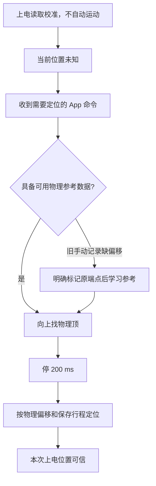

# 软件设计实现

基线：Product v15（2026-10-25）。源代码入口在 `firmware/g030_mainboard/`，具体现场行为见 [PRODUCT.md](../firmware/g030_mainboard/PRODUCT.md)。

## 模块与执行方式

| 源文件 | 职责 |
|---|---|
| `Core/Src/main.c` | HAL、时钟、GPIO 初始化，按构建选项进入应用 |
| `App/product/product_app.c` | 外设/通信/产品初始化，主循环和状态灯 |
| `App/product/motion.c`、`motion_config.h` | 运动状态、端点判定、计数及参数 |
| `App/product/product.c` | 校准、可信位置、目标、参考寻找和持久化协调 |
| `App/product/product_motor.c` | 产品电机输出与停机保护 |
| `App/product/product_button.c` | 配网/校准键消抖、短按与长按 |
| `App/product/bridge.c` | 涂鸦 DP 与产品命令、状态上报 |
| `App/eeprom.c` | 分页/跨块访问、写频率策略、读回检查 |
| `App/music.c`、`motor_tune.c` | 电机微步往返产生启动旋律 |
| `../g030_tuya/prepare_tuya_sdk.py` | 将指定涂鸦 SDK 快照移植到构建目录 |

Product 主循环依次维护电机活性、产品逻辑、通信与指示灯，TIM14/SysTick 提供脉冲及快速输入停机服务。没有把网络 SDK 阻塞调用当作运动定时器。默认固件的测试/音乐保存等诊断入口受构建隔离，不能把早期串口测试固件当作产品镜像。

## 本地控制

上电要求钮子先回中位；未保存方向映射时，第一次有效触点定义为“上”，先保存并回读，再运动。该操作映射触点，**不自动测出电机接线方向**。本机 DIR0 上卷已由实物确认，其他装配需重新核对 `PRODUCT_UP_REVERSE`。

普通操作不足 1 秒松手即停，保持满 1 秒后进入自动，到保存端点停止。反向触点首先停止，持续保持 1 秒才反转；反转后重新计时。到点后仍按住不会再次起动，必须回中位。

v15 在已知端点回中位再同向拨动时进入微调：按住持续运行，松手即停，不受旧 4799 微步配额限制，也不进入自动。已经越界时，向范围内返回仍保持手动。微调不会自动改写端点，故障、堵转和全局上限仍能停机。

## 运动和负载检测

当前上下行目标均为 9600 STEP/s，固定 1/8 微步、每转 1600 微步，名义 360 rpm。1 MHz 定时器采用 52 μs 半周期，量化转速约 360.58 rpm。加速 1000 ms，稳定等待 150 ms。

TRQ 每 5 ms 采样，最近 5 点取中位数；稳定运行后持续 80 ms 低于 `max(64, 健康基线 × 50%)` 才触发失步判定。健康下限为 ADC 128，基线缓慢上调，避免跟随负载下降而丢失端点。ADC 原始值 ≥4080 持续 50 ms 独立报故障。

首次低值时的指令步数作为事件位置，排除确认期间的多余脉冲。无编码器时，指令步数只能代表命令位移；中途失步会撤销当前位置可信状态，不能默默重写已保存端点。下端反卷检测依赖当前卷帘结构，实际最低点建议显式手动校准。

保护包括 nFAULT、ADC 异常、主循环 250 ms 失活、300000 指令步数、单段 120 秒及过程 360 秒上限。SysTick 服务无法覆盖全局关中断或核心被调试器暂停的情形，不能将它描述成独立硬件安全控制器。

## 位置、校准和重启

采用上端 100%、下端 0%。行程和当前位置均可信时按指令脉冲计算百分比并精确截止；未知时初始显示 50%，运动每 400 ms 向目标方向推进 1%，夹在 1–99%。这个显示是估计动画，不用于未知行程的中间定位。

配网键按下先停机、短按松开按最近本地方向记录端点；距离相反已知端点严格小于三圈（4800 微步）时有近端修正规则。App 两个保存按钮则明确指定上/下端，不采用该规则。长按 5 秒进入 AP 配网，不在松开时再校准。

用户设置的上端可以低于物理顶。LW9 保存两者的偏移，重启后先找真实物理顶，再回到用户坐标中的目标；首次“关闭”也可能先向上运行。STOP、本地操作或失联可取消找顶及后续定位。普通停机不保存当前位置，因此重启不能直接宣称位置可信。

## 持久化

AT24C16C 的 `0x200`、`0x210` 是两个交替 16 字节日志槽。LW9 将 26 位回绕序号、19 位行程、19 位物理顶偏移及 CRC32 等信息放入紧凑记录；兼容读取 LW7/LW8，旧手动记录缺失物理偏移时不能猜零。最新槽损坏可回退到旧有效槽。

只在方向、端点、校准/参考等明确事件后禁能、比较差异、写入并回读。每次上电最多 8 次学习保存尝试，失败也计数；普通 EEPROM 更新另有 60 秒冷却。相同记录不访问 EEPROM，普通运动与进度上报不周期写入。启动读取两个校准槽和两个音乐槽，共 4 次读、0 次写。

## 涂鸦接口

USART1 为 9600 8N1，USART2 调试为 115200 8N1。模组处理联网，STM32 处理运动；云端动作要求通信健康且模组状态为 4，本地离线控制仍可用。

| DP | 类型 | 语义 |
|---|---|---|
| 1 | Enum | open=0、stop=1、close=2；不支持 continue=3 |
| 2 | Value | 0–100 目标；上报最近接受目标 |
| 101 | Value | 当前位置/估计进度，上报用 |
| 102 | rw Bool | true 明确保存当前为上端 |
| 103 | rw Bool | true 明确保存当前为下端 |

目标滑条与当前进度分开绑定 DP2/101。DP102/103 是瞬时事件，300 ms 后回报 false、1200 ms 后补报；false 不是 EEPROM 保存成功凭证，也不触发再次校准。进度最多每 500 ms 上报一次，停机和状态变化及时上报，查询/上报不会调用运动命令。

## 启动旋律和版本隔离

电机通过正反各 5 微步产生 B1 旋律，历史验收记录为 3340 脉冲、净指令偏移 0；音乐脉冲不进入行程计数。按键占用则跳过，STOP、运动和故障可以中断。“净指令偏移 0”不等于任何机构都不会产生实际扰动。

`Product` 为当前产品；`TuyaBridge` 是模组烧录透传；`TuyaApp` 为较早 App 适配验证；`TrqCapture` 为独立采样；`Debug/Release` 是诊断分支。不能仅凭名字 `Release` 认定是要发布的产品镜像。
