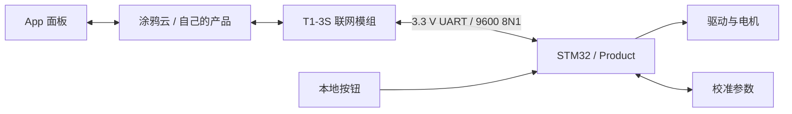

# 涂鸦接入设计方法

适用基线：Product v15，STM32G030C8T6 + T1-3S。本文公开接入方法与本项目的设计约定，帮助读者用自己的账户建立产品；不分发涂鸦模组固件、授权包或作者产品的 SDK/PID。控制台入口名称可能变化，以自己的账户和官方当前文档为准。

## 1. 系统职责

T1-3S 负责网络接入，STM32 负责运动、停止、校准、位置可信度和 EEPROM。App 发的是请求，MCU 检查状态后才执行；状态上报和全量查询不能产生新的运动命令。网络不可用时，本地控制仍按本地状态机工作。

模组固件与 STM32 应用是两个独立部分。公开本项目源码不等于公开云服务、模组固件或设备授权。模组需通过涂鸦认可渠道获得与自己产品匹配的固件和授权；本文不要求读者复制作者设备。

## 2. 在自己的账户建立产品

1. 在涂鸦开发者平台创建窗帘开关类产品，选择适合独立 MCU 串口接入的方案及 T1-3S 模组。核对账户下可用的产品方案、模组和固件是否匹配。
2. 配置下面的 DP。先确定类型、方向和枚举次序，再生成产品协议与 MCU SDK；不要只核对显示名称。
3. 保存自己的产品标识 PID，并让生成 SDK、产品协议、面板绑定使用同一个产品。不要用本仓库的占位符作为实际 PID。
4. 为自己的设备准备平台要求的模组固件和授权。作者历史验证使用过 `t1_common_user_config_ty` 3.0.22，这只是历史配置，不保证该版本目前仍适合所有新产品。
5. 创建或选择面板，按下一节绑定组件，再用自己的开发设备联调。

## 3. DP 契约

本表是当前源码的接口要求，不是可直接导入平台的产品 JSON。DP 编号属于本项目约定，不能假设其他窗帘模板一定相同。

| ID | code | 类型 / 方向 | 配置与行为 |
|---|---|---|---|
| 1 | `control` | Enum / 下发与上报 | `open=0`、`stop=1`、`close=2`；若模板还有 `continue=3`，当前固件拒绝它，面板不要暴露该动作 |
| 2 | `percent_control` | Value / 下发与上报 | 0–100，步长 1，scale 0，单位 %；请求目标，上报最近被 MCU 接受的目标 |
| 101 | `percent_state` | Value / 仅上报 | 0–100，步长 1，scale 0，单位 %；当前位置或估计进度 |
| 102 | `cali_upper_end` | Bool / 下发与上报 | true 请求将当前点保存为上端；false 不触发校准 |
| 103 | `cali_down_end` | Bool / 下发与上报 | true 请求将当前点保存为下端；false 不触发校准 |

本项目 100% 对应打开/上端，0% 对应关闭/下端。换机构时应先确认电机方向和本地操作映射；不要通过随意交换 DP 枚举来掩盖接线方向错误。

不要将目标与进度合并：例如请求 80% 时，DP2 可以显示已接受目标 80%，DP101 应随运动逐步变化。收到命令不代表已经到位。没有编码器时，未知位置的 1–99% 是估计，不是真实测量。

DP102/103 按钮在约 300 ms 后回报 false，约再隔 1200 ms 补报一次，查询与重连也复位按钮。按钮回弹只表示事件状态复位，不是 EEPROM 保存成功的凭证；应结合校准结果和重启后的行为验证保存。

## 4. 面板设计

- 开、停、关三个操作绑定 DP1 的对应枚举；不提供当前未实现的 continue。
- 目标滑条写 DP2，显示 MCU 接受的目标；当前进度显示只读 DP101。公版面板如果不能分开绑定，应调整组件或使用支持这些绑定的自定义面板。
- “保存上端”“保存下端”分别绑定 DP102/103，点击发送 true。使用瞬时操作语义，避免展示成永久开启的模式开关；接收 false 后复位显示。
- 显示“重启后首次定位可能先找顶”的说明，并保留显眼的停止操作。不要因设备重连、面板刷新或状态同步自动下发动作。

验收示例：目标设为 80% 后，目标与进度分别显示；中途停止后，进度停在当前位置，不能跳成目标值。重新打开面板应展示已有状态，而不是自动开始运动。

## 5. 串口与 SDK 接入

STM32 PA9/USART1_TX 接 T1-3S RX1（15），PA10/USART1_RX 接 TX1（16），双方共地，3.3 V 电平，9600 8N1。TX2/RX2 是模组日志接口，不替代业务 UART。CEN 用于模组复位，不等同于配网按钮。完整针序见 [PINOUT](../firmware/g030_mainboard/PINOUT.md)。

使用官方生成 SDK 完成帧解析、心跳、产品查询、网络状态和 DP 编解码。主循环持续服务 `wifi_uart_service()`，接收中断缓冲字节，避免在中断里执行长时间电机业务。不要将串口调试文本混入模组协议 UART；本项目调试日志走 USART2，115200 8N1。

项目实现对应位置：

| 文件 | 作用 |
|---|---|
| [product/bridge.c](../firmware/g030_mainboard/App/product/bridge.c) | UART 环形缓冲、SDK 调用、DP 校验、网络门控、状态上报和按钮回弹 |
| [product/product.c](../firmware/g030_mainboard/App/product/product.c) | 接受/拒绝运动请求、控制权、校准与参考恢复 |
| [product/motion.c](../firmware/g030_mainboard/App/product/motion.c) | 位置、边界和运动状态 |
| [prepare_tuya_sdk.py](../firmware/g030_tuya/prepare_tuya_sdk.py) | 对外部 SDK 模板实施受检查的移植 |
| [CMakeLists.txt](../firmware/g030_mainboard/CMakeLists.txt) | 外部 SDK 路径与 Product 构建接入 |

当前 Product 在模组状态为 4 且链路健康时允许远程运动。DP 接收处理核对长度、类型、范围及运行条件；STOP 独立处理，不能因为目标位置不可用而丢弃停止请求。串口错误、缓冲溢出、网络掉线等分支由桥接和产品层处理，不能靠 App 动画代替安全状态。

进度上报最多每 500 ms 一次，停止/状态变化及时更新。全量查询上报控制状态、接受目标、当前位置和校准按钮复位值，查询本身不启动电机。具体条件以当前源码为准。

### 新生成 SDK 的兼容点

当前脚本针对 2026-07-16 的旧模板快照（SDK 2.6.2，模板标记 2026.02.04），会追加校准 DP 定义与分发。自己的新 SDK 如果已生成 DP102/103，不能再无条件追加，否则会造成重复定义或错误处理；需要对照原生成代码适配替换规则并运行回归。生成包含全部五个 DP 的正确产品定义是目标，不应为迁就旧移植器而删掉云端功能。

保留严格模板检查：替换失败应检查模板差异，不直接删断言。具体八个依赖文件、构建命令和已有复现边界见 [SDK 准备](tuya-setup.md)。未声称任意新模板都能零修改构建。

## 6. 配网设计

本项目由 MCU 管理配网键：PC13 低有效，长按 5 秒进入 AP 配网，先停止运动，再调用 SDK 配网接口；上电时已按下须先释放，持续按住不重复触发。短按另用于端点校准，必须区分长短按。

联调时确认模组网络状态变化、App 绑定以及 DP 往返。CEN 拉低仅复位模组，不证明已经进入配网。不要把下载用 `TuyaBridge` 透传镜像当作产品运行镜像；正常使用构建 `Product`。

## 7. 建议的复现顺序与检查表

1. **核对产品定义**：五个 DP 的编号、类型、读写方向、枚举次序、百分比步长一致；PID 为自己的产品。
2. **先验串口**：确认心跳、产品查询、网络状态、DP 查询正常，没有 UART 错误或溢出；查询不能造成运动。
3. **配网和面板**：长按进入 AP，绑定自己的设备，验证 DP1/2 下发与 DP101 上报，按钮 true/false 往返。
4. **本地机构**：确认实际方向、停止与故障处理，建立本机端点校准，不导入作者 EEPROM。
5. **带载定位**：验证打开、关闭、中停、反向、目标百分比；比较目标与实际进度，确认边界外微调松手即停。
6. **校准持久化**：停止后保存上下端，检查保存结果，重启再验证；首次 App 定位可能先向物理顶寻参再到目标。
7. **异常和重连**：验证掉线、重连、重新打开面板及查询不会自行启动；进度不同步时先检查 DP 绑定，再检查上报与校准状态。

没有 SDK 可先跑 `python tools/test_host.py`；具备兼容 SDK 后运行 Product 构建与完整主机回归，命令见 [构建与使用](getting-started.md)。主机回归通过不等于自己的产品/面板/模组联调通过。第二账户全流程仍需实际执行并记录，本文不伪造该验证结果。

## 8. 常见问题

| 现象 | 先检查什么 |
|---|---|
| 能配网但 App 操作无效 | PID/DP 是否一致，枚举顺序、远程门控、本地校准状态 |
| 滑条自动回跳或进度不动 | DP2 和 DP101 是否分别绑定，步长是否为 1，上报是否收到 |
| 校准按钮一直开启 | 类型是否为 Bool/rw，面板是否接收 false，是否混用旧 SDK |
| 按钮已回弹但重启未保存 | 回弹不是成功确认，检查校准结果与 EEPROM 保存状态 |
| 首次关闭先向上 | 这是未知位置下恢复物理参考的流程，STOP 可取消 |
| 新 SDK 构建失败 | 生成模板与追加 DP 逻辑是否变化，勿直接删除适配断言 |

## 9. 官方参考与资料边界

以下官方资料用于理解通用机制；本项目具体 DP 编号、按钮时序和运动语义以本文及源码为准。

- [MCU SDK 移植说明](https://developer.tuya.com/en/docs/iot/overview-of-migrating-tuyas-mcu-sdk?id=K9hhi0xr5vll9)：串口适配、DP 处理与配网接口。
- [MCU 标准协议基础功能](https://developer.tuya.com/en/docs/mcu-standard-protocol/MCUSDK-wifi-base?id=Kd2bxu84567gk)：模组状态、DP 一致性与状态上报。
- [窗帘百分比交互说明](https://support.tuya.com/en/help/_detail/K9lct3mf3isll)：控制与百分比状态的配合。

分享自己的复现记录时保留产品配置方法、DP 契约和匿名化结果；UUID、AuthKey、设备授权文件、Wi-Fi 密码和账户凭据保留在自己的私有环境。本文发布不包含模组固件下载附件。
